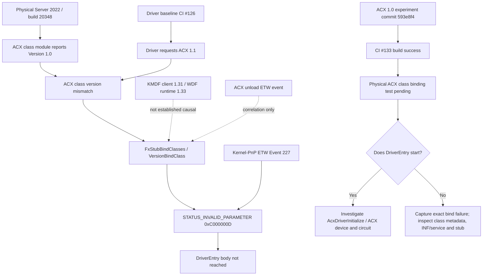

# Knowledge graph — ACX class binding failure

This graph captures the current causal model, not a claim that the root cause has already been proven.

## Nodes

- **FACT-001:** class binding fails before the driver's `DriverEntry` body.
- **FACT-002:** binding status is `0xC000000D / STATUS_INVALID_PARAMETER`.
- **FACT-003:** physical target's ACX `CLASS_MODULE Version` is `v1.0`.
- **FACT-004:** CI #126 driver baseline requested ACX 1.1.
- **FACT-005:** ACX 1.0 experiment compiles successfully in CI #133.
- **HYP-001:** the class-version mismatch is the cause of the binding failure.
- **EXP-001:** ACX 1.0 experiment, commit `593e8f4...`.
- **TEST-001:** controlled physical-host load test, not yet performed.

## Edges

- FACT-001 `SUPPORTED_BY` FACT-002.
- HYP-001 `DERIVED_FROM` FACT-002 + FACT-003 + FACT-004.
- EXP-001 `TESTED_BY` CI #133 (compile/package only).
- EXP-001 `AIMS_TO_TEST` HYP-001 on physical hardware.
- FACT-005 does not prove TEST-001.
- KMDF runtime difference and ACX unload ordering are deliberately non-causal side observations.

## New evidence and branch in the graph

- **FACT-006:** CI #133 package SYS is byte-identical to the unsigned driver artifact; INF version 0.2.326.1634.
- **FACT-007:** PDB comparison shows 221 ACX API table symbols in #126 and 210 in #133; the 11 Microsoft-listed ACX 1.1-only DDIs are absent from #133.
- **FACT-008:** all 36 ACX calls used by LDAC are present in the #133 PDB API table.
- **FACT-009:** Microsoft labels ACX 1.0 pre-release/not recommended for new development; ACX 1.1 is the public current recommendation.
- **FACT-010:** target's last recorded OS build is 20348.2849 (2024-11); later cumulative build 20348.5873 exists (2026-11).
- **HYP-002:** a later OS cumulative update may change the installed ACX runtime/class version. No evidence yet; do not assume it does.

Edges:
- FACT-007 + FACT-008 `CORROBORATE` that CI #133 is a genuine ACX 1.0 build.
- FACT-009 `QUALIFIES` EXP-001: compatibility experiment only, not production-support status.
- FACT-010 `MOTIVATES` HYP-002, but does not prove it.
- HYP-002 `REQUIRES_TEST` file version and `!wdfldr` comparison on an updated image/host before any driver installation test.

## 2026-11-22 evidence expansion

- FACT-006: ACX service DriverInit completed with status 0 in DriverDiagnostic.xml before the LDAC class-bind failure.
- FACT-007: ACX unload completion precedes LDAC Event 227 by 23.5–33.7 microseconds on the same kernel thread in two traces.
- SUPPORTED-002: ACX unload is likely cleanup after failed class binding, not the cause; this is an interpretation of event order, not proof.
- FACT-008: LdacA2dp source scan found no ACX 1.1-only DDIs from Microsoft's version-overview list.
- FACT-009: Official AudioCodec sample and LdacA2dp share the essential DriverEntry sequence and WDF service-registration pattern.
- FACT-010: Microsoft documents Universal driver support on Server 2022; the AudioCodec sample's Windows Driver setting is a valid difference but not a platform incompatibility.
- FACT-011: ACX 1.0 is described by Microsoft as pre-release/not recommended for new driver development; its presence on this exact host is observed, but Server 2022 is not listed in the ACX version table.
- EXP-002: one-variable DriverTargetPlatform A/B build, commit 6656e2d1fcda8d731f6795bd2e7a2950d5ba8309, PR #3, CI run #143 completed successfully (all 3 jobs); build/package-only, no physical bind test.

### Updated edges

- FACT-006 + FACT-007 SUPPORT SUPPORTED-002.
- FACT-008 supports ACX 1.0 source compatibility.
- FACT-009 reduces priority of DriverEntry-order and basic INF-service-registration hypotheses.
- FACT-010 reduces priority of Universal-platform invalidity hypothesis.
- FACT-011 qualifies the ACX 1.0 workaround as host-specific/experimental rather than generally supported.
- EXP-002 tests whether changing only DriverTargetPlatform changes build/package behavior; it does not prove runtime class binding.

## Added nodes — 2026-11-22

- **FACT-012:** The saved failure is logged by `FxStubBindClasses` as `VersionBindClass` for class `Acx`, status `0xC000000D`.
- **FACT-013:** Microsoft's WDF `fxldr.h` describes `WdfVersionBindClass` as the class-extension load/reference and client-link path; the WdfLdr implementation is not in the public source repository.
- **FACT-014:** KMDF 1.31 client / runtime 1.33 is a supported pairing; not the generic cause.
- **FACT-015:** Universal driver target is supported on Server 2022; platform label alone is not the cause.
- **FACT-016:** Physical host `Acx01000.sys` file version is 10.0.20348.3451; hosted runner file version is 10.0.20348.5866. This is a binary-version difference, not proof of a class-version change.
- **FACT-017:** On the disposable hosted runner, `Acx01000` was stopped by default and `sc start Acx01000` succeeded. LiveKD `-ml` captured a kernel dump, but public symbols did not expose `wdfldr!WdfLdrGlobals` for `!wdfkd.wdfldr`.
- **HYP-003:** ACX class version mismatch (client 1.1 versus host class 1.0) is the leading explanation for the `WdfVersionBindClass` failure; exact internal status mapping remains unproven.

### Edges
- FACT-012 -> FACT-013: the log identifies the WDF class-binding API described by the Microsoft header.
- FACT-012 -> HYP-003: the failure occurs at class binding, where the ACX version mismatch is relevant.
- FACT-014 -| HYP-003: KMDF 1.31/1.33 is not the mismatch being investigated.
- FACT-015 -| HYP-003: Universal is not an unsupported Server 2022 target.
- FACT-016 -> EXP-003: newer runner binary prompted a separate servicing/class-version probe.
- FACT-017 -> EXP-003: LiveKD capture works, but public WDF loader symbols block class-version enumeration.