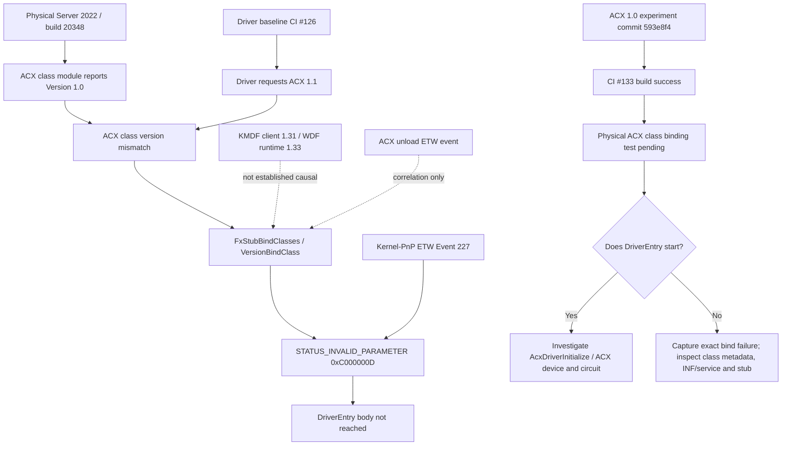

# Knowledge graph — ACX class binding failure

This graph captures the current causal model, not a claim that the root cause has already been proven.

## Nodes

- **FACT-001:** class binding fails before the driver's `DriverEntry` body.
- **FACT-002:** binding status is `0xC000000D / STATUS_INVALID_PARAMETER`.
- **FACT-003:** physical target's ACX `CLASS_MODULE Version` is `v1.0`.
- **FACT-004:** CI #126 driver baseline requested ACX 1.1.
- **FACT-005:** ACX 1.0 experiment compiles successfully in CI #133.
- **HYP-001:** the class-version mismatch is the cause of the binding failure.
- **EXP-001:** ACX 1.0 experiment, commit `593e8f4...`.
- **TEST-001:** controlled physical-host load test, not yet performed.

## Edges

- FACT-001 `SUPPORTED_BY` FACT-002.
- HYP-001 `DERIVED_FROM` FACT-002 + FACT-003 + FACT-004.
- EXP-001 `TESTED_BY` CI #133 (compile/package only).
- EXP-001 `AIMS_TO_TEST` HYP-001 on physical hardware.
- FACT-005 does not prove TEST-001.
- KMDF runtime difference and ACX unload ordering are deliberately non-causal side observations.
