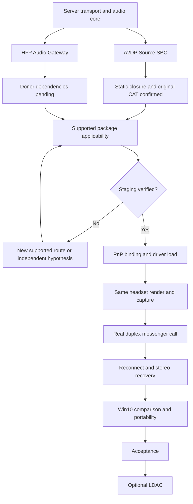

# Active decision graph — Bluetooth Classic headset
2026-11-25. Historical ACX graph: [archive](../../archive/2026-11-25/docs/agent/KNOWLEDGE_GRAPH.md).

| Decision | Status | Evidence |
|---|---|---|
| ACX 1.0 alone fixes Code 37 | REFUTED for tested candidate; parked | [45060225420](https://github.com/as-0101/ldac-a2dp-windows/actions/runs/45060225420) |
| Original CAT registration alone fixes staging | REFUTED under tested conditions | [45393451133](https://github.com/as-0101/ldac-a2dp-windows/actions/runs/45393451133) |
| Colocation or unchanged MPM-first staging resolves all | REFUTED under tested conditions | [45511693396](https://github.com/as-0101/ldac-a2dp-windows/actions/runs/45511693396) |
| Static import-name resolution proves runtime | INVALID inference | [donor results](../../research/native-inf-preflight-20261124/donor-results.md) |
| Server installed/selected optional media contains named A2DP payload | No match in tested scope; not universal absence | [optional media](../../research/native-inf-preflight-20261124/optional-media-audit.md) |
| HFP is unnecessary | SUPERSEDED by user requirement | [START_HERE](../../START_HERE.md) |
| HFP donor compatible at ABI/runtime | UNTESTED | [inventory](../../research/native-inf-preflight-20261124/hfp-inventory.md) |
| Supported signed integration route exists | HYPOTHESIS; investigate | active queue |
| Duplex call on same headset | UNTESTED | physical acceptance pending |
