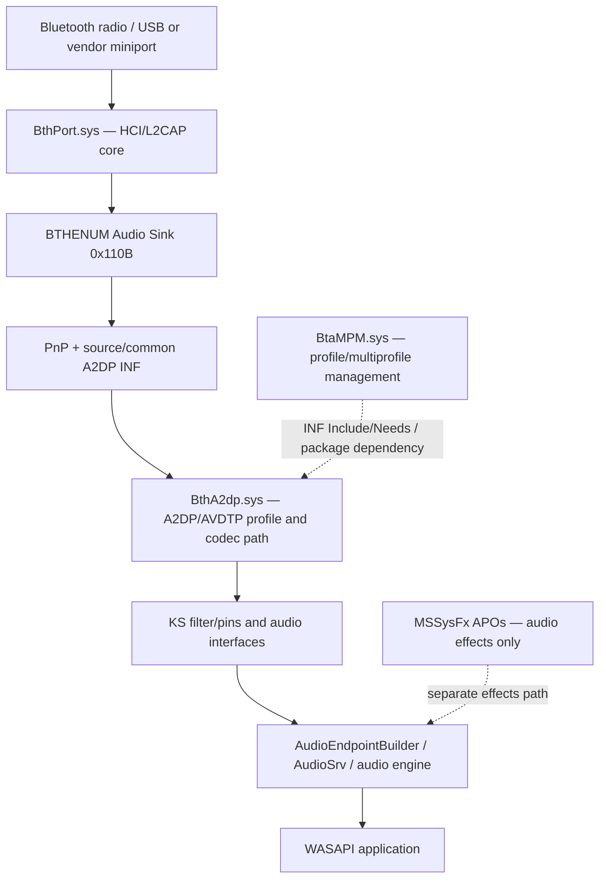

# Windows 10 Bluetooth A2DP pipeline and Server 2022 adaptation

> **Superseding update — 2026-11-24 01:42:** the 23:49 Win10 package archive already contains the common A2DP INF, source/sink INFs, btampm.inf, BthA2dp.sys and BtaMPM.sys. The earlier statement that the common INF was missing is superseded. The absence of a package-local .cat is not evidence of an unsigned inbox package: the system-supplied INFs have no CatalogFile directive and use system catalogs. The remaining package blocker is WIM/CBS component ownership and the exact source system catalog, not another Win10 export. See [WIN10_COMPONENT_AUDIT.md](WIN10_COMPONENT_AUDIT.md) for file-level identities, hashes, PE imports, licensing and unresolved items.


**Snapshot:** 2026-11-24 02:19 Europe/Kyiv  
**Scope:** A2DP stereo source only. HFP/microphone is out of scope.

## Executive conclusion

The minimal first-milestone route is to validate the existing Windows 10 Microsoft A2DP source package and its system-catalog/CBS ownership, then test it in a disposable Windows Server 2022 VM. The 23:49 capture contains the profile binding INF, common INF, btampm.inf, BthA2dp.sys and BtaMPM.sys. Do not stage until source system-catalog identity and CBS/component ownership are established.

There is **no Microsoft inbox LDAC codec in Windows 10**. Microsoft's documented Windows 10 A2DP codec set is SBC and classic aptX; AAC is listed for Windows 11, not Windows 10, and LDAC is not listed. OPPO Enco Buds2 (ETE41) advertises AAC/SBC only. Therefore the only common codec for the first milestone is **SBC**. Enco Buds2 cannot validate LDAC negotiation or LDAC audio; that later milestone needs a separate LDAC-capable receiver.

## 1. Windows 10 reference facts

Reference machine: `AS-KRM-WIN10`, Windows 10 x64, build 19045.

| Item | Captured value | Status |
|---|---|---|
| A2DP service UUID | `0000110B-0000-1000-8000-00805F9B34FB` | Present |
| Profile binding INF | `microsoft_bluetooth_a2dp_src.inf` | Present; thin source/profile binding |
| Source INF version | `10.0.19041.1` | Recorded |
| Kernel profile driver | `BthA2dp.sys` | Present |
| `BthA2dp.sys` version | `10.0.19041.4355` | Recorded |
| `BthA2dp.sys` size | `282,624` bytes | Recorded |
| `BthA2dp.sys` SHA-256 | `5FBA5EE606AAC39D9CBDA51C0A14DBABBB3A9B47BBD8AC5485ED137B4F354EC3` | Recorded |
| Common INF | `microsoft_bluetooth_a2dp.inf` | Present; Class=MEDIA, DriverVer 10.0.19041.4355 |
| Package-local catalog (.cat) | Not exported; system-supplied INFs have no CatalogFile directive | Source system catalog identity still pending |
| Include/Needs chain | Common INF and btampm.inf captured; exact graph in component audit | Static closure confirmed; CBS owner pending |

The source INF is not self-contained: it delegates to microsoft_bluetooth_a2dp.inf, which is now captured. The common INF includes ks.inf, wdmaudio.inf and BtaMpm.inf and requests the KS, WDMAudio, BtaMPM and MSSysFx sections. The captured system-supplied INFs have no CatalogFile directive; Microsoft validates such INFs through system catalogs. Identify the exact source catalog and CBS/component owner before cross-SKU staging.

The Win10 collector's Kernel-Drivers inventory reports demand-start kernel drivers as Stopped/Manual at snapshot time. This does not negate the signed PnP A2DP devnode record; do not claim `BthA2dp` was Running from that CSV.

## 2. Microsoft Bluetooth stack: component responsibilities

Microsoft documents a PnP-loaded Bluetooth profile-driver model. Profile drivers are selected through device IDs and INF matching and communicate with `BthPort.sys` through WDM requests / Bluetooth Request Blocks. This is not a user-mode codec-DLL plug-in model.

| Layer | Known components / registrations | Responsibility | Still to prove |
|---|---|---|---|
| Radio / transport | Vendor radio miniport; `BthUSB.sys` or vendor USB transport; `BthMini.sys` | Hardware-specific HCI transport | Exact Win10-to-Server binary compatibility |
| Core Bluetooth stack | `BthPort.sys`, `BthEnum.sys`, `BthLEEnum.sys`, `BthServ` service | HCI/L2CAP core and enumeration | Exact package dependencies for this A2DP source |
| A2DP profile enumeration | BTHENUM Audio Sink UUID `0x110B` | Creates the remote A2DP service devnode | Server currently binds this through a generic placeholder |
| A2DP source profile | BthA2dp.sys, service registration from source/common INF | Microsoft A2DP profile / transport | Package and System32 copies differ; package import report exists, exports/runtime codec implementation remain open |
| Common A2DP/audio registration | microsoft_bluetooth_a2dp.inf; includes ks.inf, wdmaudio.inf, BtaMpm.inf | Shared install sections, BthA2dp service and KS audio interfaces | Captured; exact graph in WIN10_COMPONENT_AUDIT.md |
| Kernel audio / KS | `ks.sys`, `portcls.sys`, `wdmaud.drv`, BtaMPM.sys and MSSysFx sections from wdmaudio.inf | Kernel Streaming, multiprofile management and system audio effects | Package closure captured; component ownership and runtime load trace pending |
| Windows audio endpoint | `AudioEndpointBuilder`, `AudioSrv`, `audioeng.dll`, `MMDevAPI.dll` | Exposes render endpoint and routes PCM | Server endpoint creation not tested |
| AVRCP control | `BthAvctpSvc`, `Microsoft.Bluetooth.AvrcpTransport.sys`, related AVCTP components | Play/pause/metadata/remote control | Not required for basic A2DP stereo |
| HFP / microphone | `BthHfEnum.sys`, `BthHfAud.sys`, gateway services | Hands-free profile and microphone | Explicitly out of scope |

The existing collectors target the core Bluetooth/audio binaries above, including BthPort.sys, BthEnum.sys, BTHUSB.sys, BthA2dp.sys, BtaMPM.sys, ks.sys, portcls.sys, wdmaud.drv, AudioEndpointBuilder.dll, AudioSrv.dll, audioeng.dll and MMDevAPI.dll. This is an inventory target list, not a final dependency graph. The common INF is now captured; the exact system catalog, PE import/export map and runtime load trace are still required to establish all edges.

### Load sequence

1. The Bluetooth bus enumerates the remote `0x110B` service as a BTHENUM devnode.
2. PnP matches the devnode to the profile INF. On the Windows 10 reference this is `microsoft_bluetooth_a2dp_src.inf`; the Server 2022 snapshot currently shows a generic `bth.inf` placeholder.
3. PnP installs/starts the profile driver service (`BthA2dp`) on demand. The profile driver communicates with `BthPort.sys`; it is not a DLL loaded by `bthserv`.
4. The profile driver's audio/KS registrations allow AudioEndpointBuilder to expose a render endpoint. The Windows audio engine then supplies PCM.
5. A2DP codec negotiation occurs in the Bluetooth profile path. Public Microsoft documentation does not identify a supported third-party codec-provider DLL interface. Do not assume an LDAC DLL can be injected into `BthA2dp.sys`.

## 3. Microsoft codecs versus third-party LDAC

### Microsoft inbox stack

- Windows 10: SBC and classic aptX.
- Windows 10: AAC is not listed as supported by the built-in stack.
- Windows 11: AAC is listed; LDAC is not listed as a built-in codec.
- No Microsoft inbox LDAC encoder DLL/provider has been identified.

### OPPO Enco Buds2

OPPO's official specification for model ETE41 lists Bluetooth codecs `AAC/SBC`. It does not list LDAC. With Windows 10's built-in A2DP stack, SBC is the common codec. A successful SBC stream is a valid first milestone, not evidence of LDAC support.

### Existing LDAC implementations found in project evidence

| Implementation | Actual component type | Function | Suitability |
|---|---|---|---|
| Repository `third_party/libldac` | AOSP source library, built as static code | Encoder API called by `service/encoder.cpp` / `ldacsvc` | Reusable encoder source, but not a Windows 10 DLL or a plug-in for `BthA2dp.sys` |
| Repository `LdacA2dp.sys` | Custom KMDF / ACX 1.1 profile driver plus user-mode service | Own AVDTP/L2CAP path | Parked; separate driver architecture, not minimal DLL adaptation |
| Alternative A2DP Driver 1.8.3.1 (BluetoothGoodies project record) | Third-party A2DP driver: AltA2DP.sys, INF oem96.inf, MEDIA class | Known from a separate Windows 11 laptop/JBL reference; negotiated LDAC | Proprietary; public support matrix is Windows 10 22H2 / Windows 11 21H2–25H2, not Server 2022; EULA restricts reverse engineering/modification/transfer. No transplant. |
| BlueCaster | User-mode WASAPI encoder + BTstack A2DP/AVDTP/L2CAP + WinUSB adapter | Supports LDAC and SBC without Windows' built-in A2DP profile | Best ready fallback if Microsoft package path fails; published OS matrix is Windows 10 22H2 / Windows 11, not Server 2022; takes ownership of selected adapter |
| OpenA2DP | Pre-alpha custom A2DP driver project | Experimental driver-based stack | Not a ready binary; do not switch to it now |

The repository's `third_party/libldac` derives from Android Open Source Project `external/libldac`. The repository NOTICE says LDAC certification requirements are separate from the source-code license. Do not equate an Apache-licensed source tree with permission to ship a certified LDAC product.

## 4. Windows Server 2022 comparison

Windows Server 2022 build 20348 / UBR 5761 is not an officially supported in-box Bluetooth client SKU according to Microsoft's Bluetooth support matrix. Third-party IHV drivers may provide hardware support, but that does not imply the A2DP profile package is present.

The latest recorded Server evidence is the 2026-11-23 20:41 Kyiv archive, not a live query. It records:

- Core Bluetooth components and the Intel radio stack are present.
- OPPO A2DP service UUID `0x110B` is enumerated, but the node is handled by generic `bth.inf` / `BthGenericService`, not the Microsoft `BthA2dp` profile package.
- No `BthA2dp.sys` / Microsoft A2DP source package was found in the Server inventory.
- The last recorded custom target node used `oem75.inf`, driver `0.2.325.1600`, Code 37 / `0xC000000D`.

Do not claim this is the current live state; the physical server was not queried during this run. No installation, device restart, BCD/security change, certificate change, or OS change was performed.

## 5. Minimal adaptation path

1. **Use the existing 23:49 package capture.** The source/common/sink INFs and BthA2dp/BtaMPM binaries are already present. Do not rerun the exporter. The next evidence is WIM/CBS package ownership and the exact system catalog.
2. **Audit before staging.** Verify source/common INF versions, DriverVer, NTamd64 decorations, Include/Needs, service/interface registrations, package folder contents, and membership of each SYS in the source system catalog. Parse each PE for machine type, version resource, imports, delay imports, exports, API-set references and OS assumptions. Compare each dependency with the Server 2022 counterpart.
3. **Do not edit the Microsoft package yet.** Editing an INF changes catalog-covered content and invalidates the original package signature. First test the original signed package in a disposable Server 2022 VM. Do not copy only `BthA2dp.sys` or invent registry registrations.
4. **Test in order:** service start → BTHENUM enumeration → profile driver load / PnP problem code 0 → A2DP render endpoint → SBC AVDTP negotiation → actual RTP media stream and audible stereo.
5. **Only after SBC passes**, test LDAC using an LDAC-capable sink. Enco Buds2 cannot be used for that stage. Require observed LDAC vendor-specific AVDTP configuration and real LDAC media frames; endpoint presence alone is not proof.
6. If the original package is blocked by an OS decoration or dependency, identify the exact blocker and propose one minimal change. Any INF/catalog/signing experiment belongs only in a disposable VM and a separate experimental branch.

## 6. Explicitly parked work

- No new Bluetooth stack or A2DP/ACX driver from scratch.
- No ACX AudioCodec bind-probe as the next step.
- CI #248 and CI #255 are closed historical evidence; do not repeat them.
- No code changes on `docs/project-source-reorg`; documentation only.
- No physical Server 2022 driver install, device restart, BCD/test-signing/security change, certificate change, OS update/rollback, or installer/rollback script execution.

## 7. Component availability and existing alternatives — 2026-11-23 23:40

### 7.1 Microsoft inbox A2DP is a profile-driver path, not a documented codec-DLL plug-in system

Microsoft's documented flow is: Bluetooth stack discovers paired devices, PnP selects a profile driver using device IDs and INF registration, and the profile driver sends IRPs/BRBs down to `Bthport.sys`. Microsoft documents Windows 10 A2DP codecs as SBC and aptX Classic; it does not list LDAC or a separate inbox LDAC codec DLL. Therefore:

- `BthA2dp.sys` is the Microsoft A2DP profile/transport driver, not an LDAC codec DLL.
- The source/common INF package and its system-catalog membership are required for a valid profile binding; do not copy only the SYS.
- A standalone LDAC encoder DLL would not automatically be loaded by the Microsoft profile driver. No public user-mode codec-provider DLL hook is documented in the Microsoft driver-stack model.
- Any private codec interface would need to be proven from the actual binary/import/export/registry evidence; it must not be assumed.

Sources: [Bluetooth Classic audio](https://learn.microsoft.com/en-us/windows-hardware/drivers/bluetooth/bluetooth-classic-audio), [Using the Bluetooth driver stack](https://learn.microsoft.com/en-us/windows-hardware/drivers/bluetooth/using-the-bluetooth-driver-stack), [Bluetooth support in previous Windows versions](https://learn.microsoft.com/en-us/windows-hardware/drivers/bluetooth/bluetooth-support-in-previous-windows-versions).

### 7.2 Existing third-party LDAC paths

| Implementation | What it actually is | Published platform / constraints | Project disposition |
|---|---|---|---|
| Alternative A2DP Driver 1.8.3 | Third-party signed A2DP kernel driver, not a codec DLL; uses the Windows inbox Bluetooth stack | Official matrix: Windows 10 22H2 and Windows 11 21H2–25H2; no Server 2022 entry. EULA restricts reverse engineering, modification and transfer. | Do not transplant or reverse-engineer; use only as-is on supported, licensed hardware or with explicit vendor authorization for Server evaluation. |
| BlueCaster 3.0.4 | Open-source user-mode stack: WASAPI capture → codec encoders (including LDAC) → BTstack A2DP/AVDTP/L2CAP → WinUSB → USB Bluetooth adapter | Windows 10 22H2 / Windows 11; requires a USB adapter and takes it over from Windows while active. Server 2022 is not listed. | Fallback only, preferably disposable VM + dedicated USB adapter; not a Microsoft-stack plug-in. |

Official sources: [Alternative A2DP version history](https://www.bluetoothgoodies.com/a2dp/version-history/), [Alternative A2DP FAQ](https://www.bluetoothgoodies.com/a2dp/faq/), [Alternative A2DP EULA](https://www.bluetoothgoodies.com/a2dp/eula/), [BlueCaster source](https://github.com/SeiyaFunaokaJP/BlueCaster), [BlueCaster architecture](https://seiyafunaokajp.github.io/BlueCaster/architecture).

### 7.3 Project-owned LDAC code is static source, not a Windows 10 DLL

The repository CMake file declares `ldacBT_enc` and `ldacBT_abr` as `STATIC` libraries and links them into `ldacsvc_core`. `service/encoder.cpp` calls the AOSP LDAC encoder API. This proves the current project owns reusable encoder source, but it does not establish a DLL that Microsoft `BthA2dp.sys` can load.

Source: [CMakeLists.txt](https://github.com/as-0101/ldac-a2dp-windows/blob/docs/project-source-reorg/CMakeLists.txt), [service/encoder.cpp](https://github.com/as-0101/ldac-a2dp-windows/blob/docs/project-source-reorg/service/encoder.cpp).

### 7.4 Targeted exporter audit

The existing `Export-Win10-A2DP-Package.ps1` is 5,108 bytes / 95 lines and read-only. It scans `DriverStore\\FileRepository` and `%windir%\\INF` for a fixed list of A2DP/AVRCP/HFP INFs, copies matching DriverStore package directories and `BthA2dp.sys`, and writes direct Include/Needs, file version, SHA-256 and Authenticode status.

It does not search WinSxS, recursively resolve all included INF files, inventory the complete DLL/COM provider set, parse PE imports/exports/delay imports, or verify catalog membership. The 23:49 archive already recovered the common INF and package files. The exporter is no longer the next action. Use WinSxS/CBS only to establish component ownership and locate the system catalog; full PE exports/delay imports and runtime dependency checks remain separate.

The broader Win10 collector with `-IncludeDriverPackages` and the Win10/Server comparison collector are already in Library. Use them before creating another collection tool.


## 8. File-level audit result — 2026-11-24 01:42

- Source INF matches remote A2DP Sink UUID 0x110B. The reverse-direction sink INF is not needed for playback to earbuds.
- Common INF: Class=MEDIA, DriverVer 10.0.19041.4355; Include ks.inf, wdmaudio.inf, BtaMpm.inf; Needs KS.Registration, WDMAUDIO.Registration, BtaMPM.CopyFilesOnly and mssysfx.CopyFilesAndRegister; installs BthA2dp as a demand-start kernel service and registers KSCATEGORY_AUDIO interfaces.
- btampm.inf: Class=SYSTEM, DriverVer 10.0.19041.5848; CopyFilesOnly dependency for BtaMPM.sys.
- DriverStore BthA2dp.sys: 282,624 bytes, SHA-256 5FBA..., version 10.0.19041.4355; PE32+ x64, native kernel, no delay-import directory, direct imports from ntoskrnl.exe only in E-119.
- A separate System32 BthA2dp.sys is 279,040 bytes, SHA-256 0442..., with 8 import descriptors / 144 imported functions. Secondary public inventories list a 279,040-byte BthA2dp.sys as 10.0.19041.1, but do not publish the hash; the mapping remains provisional. It is a different file and its imports must not be applied to the DriverStore package copy. Prioritize the 10.0.19041.4355 DriverStore copy for compatibility analysis.
- BtaMPM.sys: 43,008 bytes, SHA-256 DA5C..., version 10.0.19041.5848; imports ntoskrnl.exe, cng.sys and WppRecorder.sys. It is profile/multiprofile management, not an LDAC codec.
- WMALFXGFXDSP.dll and SysFxUI.dll are system audio-effect/APO support from the MSSysFx path; they are not LDAC encoder DLLs.
- Microsoft Windows 10 Classic Audio lists SBC and aptX Classic, not LDAC or AAC. OPPO Enco Buds2 lists AAC/SBC only. The common codec for this pair is SBC.
- The published Alternative A2DP driver adds LDAC but is proprietary and license-restricted; no binary transplant or reverse engineering.

Full file/PE map and source links: [WIN10_COMPONENT_AUDIT.md](WIN10_COMPONENT_AUDIT.md).


> PnP correction: the last recorded OPPO BTHENUM 0x110B node is bound to the project's custom oem75.inf / LdacA2dp service, not Microsoft or Realtek. The node is present; Code 37 is a custom-driver start failure, not a Microsoft package test. See WIN10_COMPONENT_AUDIT.md.


### Server services and residual Realtek package

The archived Server 2022 environment report records bthserv, Audiosrv and AudioEndpointBuilder running; BTAGService and BthAvctpSvc not installed. BTAGService is HFP/audio-gateway (out of scope); BthAvctpSvc is AVCTP/AVRCP control and is not a prerequisite for the core A2DP audio stream. The core bthport.sys, bthusb.sys, bthenum.sys and bthmini.sys files are present, while btha2dp.sys is absent from System32\\drivers.

A DriverStore folder named rtka2dp.inf_amd64_0fd0faf5e73b2466 is present, but the captured A2DP INF investigation did not export its INF bytes or version. Public Realtek driver catalogs associate legacy rtka2dp.inf packages with LOCALMFG&005D IDs; the current local radio uses LOCALMFG&0002 (Intel), while the Realtek package targets LOCALMFG&005D. The current OPPO A2DP service node is actually bound to the custom oem75.inf. Do not treat rtka2dp.inf as the active OPPO driver or as an LDAC candidate.


## 7. Codec ownership and provider boundary — 2026-11-24 02:19

The Windows 10 path is a profile-driver pipeline, not a codec-DLL plug-in chain:



- The source INF is the playback-to-earbuds direction. The sink INF is the reverse direction and is not required for the PC-to-OPPO playback milestone.
- The common INF is Class=MEDIA, DriverVer 10.0.19041.4355. It includes `ks.inf`, `wdmaudio.inf` and `BtaMpm.inf`, registers `BthA2dp` as a demand-start kernel service, and registers KS audio interfaces.
- `btampm.inf` is Class=SYSTEM, DriverVer 10.0.19041.5848; its CopyFilesOnly section supplies `BtaMPM.sys`. This is not the LDAC encoder.
- The `mssysfx.CopyFilesAndRegister` / APO path supplies audio processing effects. It is not a documented A2DP codec provider.
- Microsoft's documented A2DP codecs for Windows 10 are SBC and aptX Classic. There is no inbox LDAC DLL. The public 17763.168 BthA2dp PDB shows SBC/aptX codec classes inside the profile driver; treat this as older-build corroboration only.
- The project AOSP `libldac` source is already statically linked into its own service; it cannot be registered into the Microsoft profile driver through any documented user-mode codec-provider contract found in the reviewed sources.

### Later LDAC alternatives (not the SBC path)

BlueCaster v3.0.4 is an existing user-mode A2DP implementation using BTstack+WinUSB and advertising LDAC. It bypasses the Windows Bluetooth stack, takes over a USB adapter through WinUSB, lists Windows 10 22H2/Windows 11 but not Server 2022, and includes BTstack under a personal/non-commercial license. Keep it as a disposable-VM candidate only; it is not a drop-in DLL and must not be installed on the physical Server.

OPPO Enco Buds2 ETE41 is AAC/SBC only. It can validate the SBC stream, but a later LDAC negotiation/audio test requires a different sink that advertises LDAC.

### Static PE audit quality correction

The Library `pe_imports_a2dp.py` repeats the same import descriptor because it does not advance the descriptor pointer by 20 bytes. Its 1.3 MB report is invalid for dependency analysis. Reports (2)/(3) are separate, but their corrected parser source was not retained. Re-run the exact package binaries with Dependencies/PEInspector and retain the script/output pair. Keep the 282,624-byte DriverStore binary and the 279,040-byte System32 binary separate.


## 8. Server 2022 support-scope boundary — 2026-11-24 02:48

Microsoft's previous-Windows support page states that all Windows Server SKUs lack in-box Bluetooth wireless technology support, but third-party IHV drivers may be available. It lists A2DP/AVDTP among Windows 10 in-box profiles, not Server profiles. The component-guidelines page separately lists Windows Server 2022 under Bluetooth Host Subsystem QD ID 130847. That is a qualification record, not an in-box A2DP driver.

Therefore, the Server side must be analyzed as three distinct layers: vendor radio/transport + third-party host stack; Microsoft Bluetooth core/host-subsystem interfaces; and the A2DP profile/KS endpoint package. A functioning radio or BthPort-like core does not prove A2DP profile availability. The target remains to add only the minimum compatible A2DP profile package for SBC, not to replace the radio transport or build a new stack.


## 2026-11-24 component-pipeline evidence

The Microsoft Server 2022 KB5126655 package scan contains Bluetooth core packages but no Windows client A2DP profile INF/SYS or BtaMPM manifest references. The Windows 10 cumulative-update scan finds the A2DP and BtaMPM components, but their SYS payloads in the update CAB are PSF forward deltas rather than full PE files.

Do not infer an LDAC user-mode codec DLL from the presence of A2DP transport. The Windows 10 A2DP profile path and the AOSP libldac encoder remain separate components. Exact Windows 10 PE imports/exports and Server 20348.5761 export compatibility are pending the full-image extraction workflow.

The next experiment is WIN10_UUP_IMAGE_AUDIT.md, not ACX bind-probe.

## 2026-11-24 05:20 — explicit A2DP pipeline and LDAC boundary

### Device enumeration and endpoint creation

```text
Bluetooth radio / vendor miniport
  → BthPort.sys (HCI/L2CAP host core)
  → BthEnum.sys / BTHENUM PnP device for remote service UUID 0x110B
  → microsoft_bluetooth_a2dp_src.inf
  → microsoft_bluetooth_a2dp.inf (common install)
       → BthA2dp.sys (demand-start kernel A2DP/AVDTP profile driver)
       → BtaMPM.sys (profile/multiprofile management dependency)
       → KS audio interfaces (KSCATEGORY_AUDIO, A2DP source endpoint)
  → AudioEndpointBuilder / MMDevices creates the render endpoint
```

### PCM-to-radio media path

```text
WASAPI application
  → AudioSrv / Windows audio engine
  → MSSysFx APO effects (when enabled)
  → KS render endpoint exposed by BthA2dp.sys
  → BthA2dp A2DP/AVDTP media path (SBC or another negotiated codec)
  → BthPort / L2CAP
  → remote A2DP Sink (OPPO Enco Buds2)
```

The source INF is the PC-to-headphones playback direction and matches remote A2DP Sink UUID 0x110B. The reverse-direction sink INF is not needed for the OPPO playback milestone. BthA2dp owns the A2DP/AVDTP profile and inbox codec path; it is not merely a generic transport shim. BtaMPM is profile management, not an LDAC encoder. BthPort is the Bluetooth host transport/core; the profile-driver relationship uses the Bluetooth driver interface/IRP path rather than a normal PE import.

### INF registrations and dependencies

The common INF uses `Include=ks.inf,wdmaudio.inf,BtaMpm.inf` and `Needs=KS.Registration,WDMAUDIO.Registration,BtaMPM.CopyFilesOnly,mssysfx.CopyFilesAndRegister`. It installs BthA2dp as a kernel driver with demand start (StartType 3) and `%12%\BthA2dp.sys` as ServiceBinary. It registers KSCATEGORY_AUDIO source/sink interfaces and endpoint properties under the MSEP property store. The archived Server comparison already contains ks.inf, wdmaudio.inf, WMALFXGFXDSP.dll and SysFxUI.dll; the exact Server UUP image must confirm versions/registrations. BtaMpm.inf/BtaMPM.sys remains a profile-specific dependency.

### COM boundary

No generic COM A2DP codec-provider contract or LDAC CLSID was found in the reviewed Microsoft INFs or project binaries. MSSysFx APOs are user-mode COM objects but process audio effects in the Windows audio engine; they are not A2DP codec negotiation providers. Registering an arbitrary LDAC DLL as an APO would not add LDAC to AVDTP negotiation.

### LDAC boundary

Microsoft's Windows 10 inbox A2DP codec list is SBC and aptX Classic; it contains no LDAC codec/provider DLL. The project's AOSP libldac is compiled as static encoder libraries and called by its own service; it is not a plug-in to BthA2dp.sys. A later LDAC milestone needs an A2DP transport that explicitly advertises LDAC and a sink that supports it. OPPO Enco Buds2 ETE41 is AAC/SBC only, so it can validate SBC but cannot validate LDAC.

